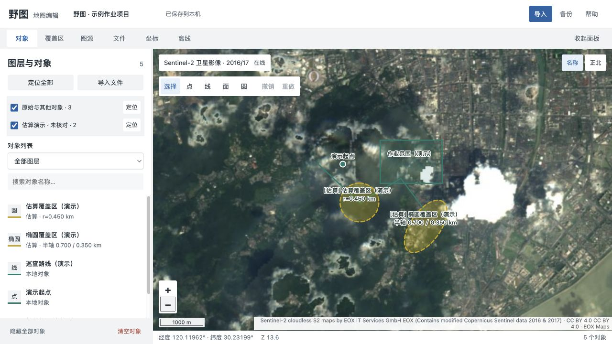
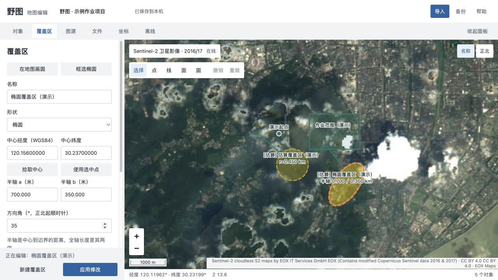

# 野图 · Field Atlas

**拿到地图文件后，还要在几个工具之间来回核对、编辑、做离线包？**

野图是一个在自己电脑上运行的二维地图工作台：查看和编辑标准地理文件，把不确定的覆盖区明确标为估算，下载允许离线的底图，并保留可恢复的本地历史。

[快速运行](#快速运行) · [演示数据](#先用演示数据试一遍) · [版本说明](https://github.com/lanjunyao/field-atlas/releases/tag/v0.2.0) · [反馈问题](https://github.com/lanjunyao/field-atlas/issues)



*真实运行界面，标注为合成演示数据；卫星底图为 EOX Sentinel-2 历史影像。仓库不包含私人作业数据或地图包。*

## 为什么做野图：三个具体痛点

| 场景里的麻烦 | 野图怎么处理 | 得到什么 |
| --- | --- | --- |
| 导出的 GeoJSON 只有点和面，截图里却还有圆、椭圆；原参数丢了，不敢直接改原文件 | 保留原几何，另建估算图层，记录来源；圆和椭圆可以用中心、半径、半轴、方向编辑 | 先把可确认的数据与待核对的范围分开，避免把估算当作原始成果 |
| 办公室能打开地图，到了网络差的现场，底图变空白 | 按作业范围制作允许下载的 XYZ/TMS 栅格离线包，导入导出 MBTiles；离线模式只读本地瓦片 | 提前带走一片区域，清楚知道覆盖范围与可用级别 |
| 编辑后遇到窗口刷新、保存断连或服务崩溃，不知道哪些修改还在 | 自动历史快照、浏览器草稿、版本冲突检测与后台重启 | 可以核对、导出历史版本，并在中断后恢复已提交编辑 |

适合个人标绘、巡检范围整理、标准地理文件交换和 GIS 学习。当前是 **0.2.0 试用版**，重要成果请保留独立备份，并用控制点核验精度。

## 能做什么

- **地图与编辑**：二维平移缩放、对象定位、点线面绘制、顶点修改、撤销重做、名称/备注/颜色、图层显隐。
- **参数覆盖区**：手绘或输入圆/椭圆，区分估算与手工参数；标准 Polygon 边界携带可再编辑的扩展参数。
- **文件交换**：GeoJSON、KML、KMZ、GPX、CSV。GPX 限点线，CSV 限点；遇到不支持的几何会提示。
- **二维坐标转换**：WGS84、Web Mercator、UTM、自定义 PROJ；识别 GeoJSON 声明的 CRS，包括 EPSG:4490。
- **区域离线**：框选或按对象范围生成包、估算数量、暂停续传、失败重试、MBTiles 导入导出；遇到图源 HTTP 429 会暂停。
- **本地恢复**：原子保存、落盘同步、带校验的历史备份、损坏主文件恢复、IndexedDB 草稿和多个窗口的版本冲突保护。



*合成覆盖区演示。普通多边形不会被自动推断成圆；参数不完整的文件无法自动恢复精确圆形。*

## 快速运行

需要 **Node.js 22.13+、npm 和现代浏览器**。主要在 Apple Silicon Mac 上验证；项目是本地网页应用，服务只监听 `127.0.0.1`。

```sh
git clone https://github.com/lanjunyao/field-atlas.git
cd field-atlas
npm ci
npm run build
npm start
```

打开 **http://127.0.0.1:9847**。看到地图、左侧对象列表和“已保存到本机”即已启动。首次启动无需 API Key；默认在线底图需要网络，演练网格可离线使用。

已有野图用户若要隔离试用数据，可先指定一个新目录：

```sh
FIELD_ATLAS_DATA="$PWD/data" npm start
```

配置项见 [.env.example](.env.example)。程序不自动读取 `.env`，请通过 shell 导出变量。端口可用 `PORT` 设置。源码启动用 `Ctrl+C` 停止。

### 先用演示数据试一遍

1. “文件 → 示例数据 → 载入示例”，或导入 [West Lake 示例](public/samples/westlake.geojson)。
2. 选择对象，修改名称或拖动顶点，再撤销；原文件不会被原地写回。
3. “覆盖区”输入中心和半径，或导入 [圆与椭圆演示](samples/圆与椭圆功能演示.geojson)。
4. 离线页选择“离线演练底图”，使用示例区域，创建包后点击“使用”；演练底图是合成网格。
5. “文件 → 自动历史备份”查看和导出版本。要迁移完整工作，还需单独导出 MBTiles。

### 在 Mac 上自行打包

```sh
npm run package:mac
```

在上一级生成 `野图.app`，内置**当前构建机器的 Node 运行时与架构**。打包脚本需要联网安装生产依赖；目前主要验证 Apple Silicon。应用使用 Chrome 独立窗口，缺少 Chrome 时打开默认浏览器。后台服务关闭方式见 [运行与恢复](docs/OPERATIONS.md)。

本次公开 Release 提供源码试用入口，**没有提供已签名、公证的 Mac 安装包**。自行构建的包也未签名、公证；请先阅读并核对源码再运行。

## 卫星图源、离线范围和精度

内置 EOX Sentinel-2 cloudless **2016/2017 历史影像**，有明确年份和署名。它用于区域地形对照，不能代表最新地物现状。[EOX 来源与下载说明](https://new.eox.at/2017/08/sentinel-2-global-cloudless-mosaic/) · [2016 版许可说明](https://new.eox.at/2024/08/sentinel-2-cloudless-2023/)

- 软件许可与影像许可分别适用；EOX 2016 版为 CC BY 4.0，较新年份须另核对相应条件。
- 内置 OpenStreetMap 仅在线浏览，禁止通过修改预设开启区域批量下载。
- 自定义图源须具有相应使用/下载权限。演示服务可能限流，不保证持续可用。
- 单包最多 5,000 张瓦片；MBTiles 只支持 PNG/JPEG/WebP 栅格，不支持 PBF 矢量瓦片。
- 包外没有影像；放大到更高层级不会产生新的地物细节。
- CGCS2000 跨基准叠加为近似处理；没有格网、高程或实测转换参数，不能据此承诺工程精度。

## 数据保存在什么地方

对象、图源、视图与历史备份保存在本机。Mac 默认目录是 `~/Library/Application Support/FieldAtlas/`；其他平台默认使用项目 `data/`。可用 `FIELD_ATLAS_DATA` 指定独立目录。

在线底图会向所选图源请求当前视野的瓦片，瓦片地址能够透露大致查看区域。自定义图源经本地服务代理。程序没有遥测、云端 AI、账号系统或自动上传项目文件的功能。图源 URL 的查询参数会保存在项目及备份中，分享前须清理私人令牌。详情见 [隐私与网络](docs/PRIVACY.md)。

## 验证与贡献

```sh
npm test
npx playwright install chromium  # 没有可用的本机 Chrome 时
npm run test:ui
```

公开测试全部使用**从零生成的合成数据**，覆盖文件往返、真实拖动、草稿恢复、旧请求排队、进程强杀重启、损坏主文件恢复和 MBTiles 生命周期。测试使用临时数据目录。发布前在干净副本验证了 **19 项核心/API 测试与 17 项浏览器测试**；远端 CI 状态以 Actions 页面为准。

欢迎提交带最小复现的 Issue 或 PR。不要在 Issue 中上传私人坐标、业务 GeoJSON、带令牌的图源地址或完整数据目录。[贡献说明](CONTRIBUTING.md)

当前不支持奥维私有 SDB/OVOBJ/OVMAP 全面兼容、CAD、GeoTIFF、完整 WMTS capabilities 接入、GCJ02/BD09、三维地形或精确截图配准；仓库也不包含其他地图软件的二进制、反编译产物及私有素材。

如果它解决了你整理地图数据、外场离线或误操作恢复的问题，欢迎点 **Star** 收藏，也欢迎反馈实际使用中的缺口。

## 许可与致谢

野图代码采用 [MIT License](LICENSE)。由 OpenLayers、Proj4js、PapaParse、JSZip、Express、Multer、SQLite 等组件支持，第三方版权及许可证见 [THIRD_PARTY_NOTICES.txt](THIRD_PARTY_NOTICES.txt)。底图和影像沿用各自的数据许可与署名。
